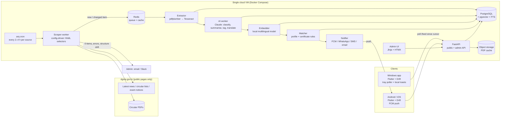

# Architecture (Phase 0)

> Working name in this doc: **the app**. The name "DG Alerts" is under review — see [decisions.md](decisions.md#d1-product-name).

## 1. Repository layout

```
/
├── backend/            FastAPI service (public API + admin API), SQLAlchemy models, Alembic migrations
│   ├── app/
│   │   ├── api/        routers: auth, me, feed, documents, search, ask, certificates, sea_service, checks, exams, admin
│   │   ├── core/       settings (pydantic-settings, env only), security, logging
│   │   ├── db/         models, session, migrations/ (Alembic)
│   │   ├── services/   matching, notifications, ai (Claude client), embeddings, export
│   │   └── workers/    arq task definitions shared with /scraper
│   └── tests/
├── scraper/            Source fetchers + pipeline steps (run as an arq worker)
│   ├── sources/        one YAML file per DGMA page (selectors, pagination, doc_type hints)
│   ├── fetch/          polite HTTP client (robots, UA, ≥5 s spacing, retries)
│   ├── extract/        pdfplumber → Tesseract OCR fallback
│   ├── pipeline/       detect → extract → classify → summarise → tag → embed → match → notify
│   └── tests/fixtures/ saved HTML/PDF snapshots (clearly labelled test fixtures)
├── app/                Flutter app (Windows → Android/iOS)
│   ├── lib/
│   │   ├── core/       routing (go_router), theme, l10n (ARB files ×8 languages), api client
│   │   ├── data/       Drift database, repositories, sync engine
│   │   ├── features/   onboarding, feed, document, search, wallet, reminders, exams, checks, ask, sea_time, export, settings
│   │   └── platform/   notifications, OCR, secure storage, file encryption (per-platform adapters)
│   └── test/           unit + widget tests
├── admin/              Admin web UI: FastAPI + Jinja2 + HTMX templates (served by backend under /admin)
├── infra/              docker-compose.yml, Dockerfiles, Caddy (TLS) config, deploy scripts, backup cron
└── docs/               this plan, OpenAPI, schema, test checklist, runbooks
```

## 2. System diagram



## 3. Document pipeline (idempotent steps)

Each step is an arq job keyed by `(document_id, step, content_hash)`; re-running a job with the same key is a no-op. Retries use exponential backoff (max 5); final failure sets `documents.status = failed` and creates an admin task.

| Step | Input → output | Notes |
|---|---|---|
| 1. Detect | listing page → `documents` row | New = unseen `source_url`. Changed = same URL with a new `pdf_hash`, or a title matching `addendum|corrigendum|amendment|supersession` that references an existing circular number → `document_versions` row + `related_document_id`. |
| 2. Extract | PDF → `raw_text` | pdfplumber; if < 200 chars/page, OCR with Tesseract (eng+hin). Stores page count and extraction method. |
| 3. Classify | text → doc_type, tags, confidence | Claude with a JSON schema. Confidence < 0.7 or doc_type `unknown` → `needs_review`, held from broadcast. |
| 4. Summarise | text → English summary | Structured JSON: short, detailed, who_affected, action_required, deadline, key_points, `uncertain_fields[]`. Prompt forbids inventing numbers or dates; values are checked against the source text (any circular number or date not found in `raw_text` → flagged). |
| 5. Translate | EN summary → 7 languages | Done lazily on first request per language (premium), then cached. Admin can pre-warm. |
| 6. Embed | chunks → pgvector | ~800-token chunks with page numbers for citations. |
| 7. Match | tags × users → `alerts` | Rules engine (pure function, unit-tested). Unique `(user_id, document_id, channel)` prevents duplicate alerts. |
| 8. Notify | `alerts` → channels | Respects quiet hours (IST) except `critical`. Critical security advisories skip steps 3–5 if they fail: title + link go out anyway. |

## 4. Client architecture (Flutter)

- **State:** Riverpod (code-gen providers). **Routing:** go_router. **DB:** Drift (SQLite), which is the source of truth for the UI. Network only updates Drift.
- **Sync engine:** pull with `/sync/changes?since=<cursor>`, which returns text summaries only (< 5 KB each). PDFs download on demand. Push uses a local outbox table, client-generated UUIDs, `updated_at` + `version`, and last-writer-wins per field, with conflicts kept for the user to review.
- **Data saver:** no PDF prefetch, no images, a longer poll interval, and only the language the user chose.
- **Windows notifications:** FCM does not support Windows desktop. While the app runs (optionally from the system tray at login), it polls `/feed` every 30 min and shows local toasts with `flutter_local_notifications` (Windows support). Certificate expiry reminders are scheduled locally on all platforms, so they work offline.
- **Mobile notifications:** FCM data messages, with local scheduling for expiry reminders.
- **OCR:** Windows uses the built-in `Windows.Media.Ocr` through a small platform channel (no Tesseract bundle needed). Mobile uses ML Kit. All OCR runs on the device.
- **File encryption:** certificate images are encrypted with AES-256-GCM. The key is stored in `flutter_secure_storage` (DPAPI/Credential Manager on Windows, Keystore on Android, Keychain on iOS).

## 5. Security and privacy (DPDP Act 2023)

- Consent is recorded per purpose (`consents` table) at signup, and users can withdraw it from Settings.
- Data minimisation: certificate **files** stay on the device by default (see decision D5), and only certificate metadata syncs.
- `GET /me/export` returns a ZIP of all user data. `DELETE /me` hard-deletes the user within 24 h and logs it in `admin_audit_log` without personal data.
- TLS through Caddy (automatic HTTPS). Secrets come from env only. Postgres is not exposed publicly. Backups are encrypted nightly.
- The admin UI is behind separate admin accounts with TOTP 2FA, and every admin write is audit-logged.

## 6. Environments

| Env | How |
|---|---|
| Local | `docker compose up` (postgres+pgvector, redis, backend, worker, caddy). The Flutter app runs natively. |
| Staging/Prod | One VM (2 vCPU / 4 GB is enough at launch; the embedding model needs ~1 GB RAM), the same compose file, and an env file per environment. |
| CI | GitHub Actions: lint + tests for backend/scraper; `flutter test` + Windows build. iOS builds need a macOS runner or Codemagic (decision D3). |
